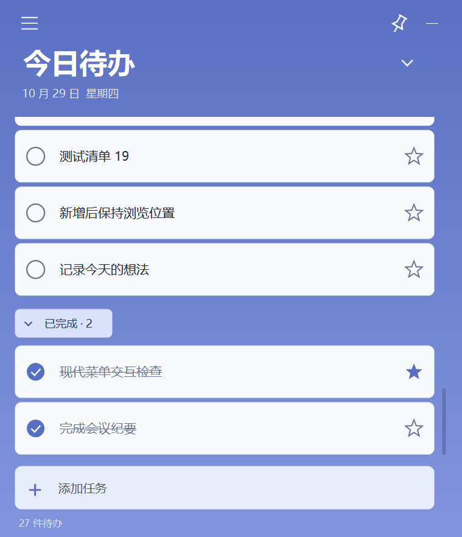
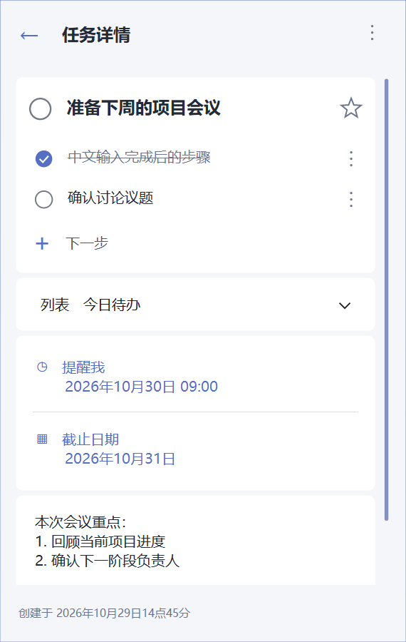

# DesktopTodo · 桌面待办


最初只是想让 Microsoft To Do 贴在 Windows 桌面上：打开其他窗口时，它自然留在桌面层，不占用工作窗口的空间。后来围绕这个需求，做成了这个蓝白风格的独立待办小组件。

**当前版本：v2.0.5 · Windows 10 / 11 · MIT License**

[下载最新版本](https://github.com/babelturm/DesktopTodo/releases/latest) · [使用说明](docs/usage.zh-CN.md)

## 功能

- **贴在桌面层**：像桌面小组件一样使用；大头针可锁定位置和大小。
- **列表分类**：今日待办、本月目标、年度计划，也可以自定义名称、移动任务。
- **任务详情**：步骤、备注、重要标记、截止日期和创建时间。
- **提醒**：指定日期时间或倒计时，通过 Windows 系统通知提醒。
- **已完成折叠**：完成的任务收在列表下方，可随时展开或恢复为待办。
- **本地保存**：无需账号，支持备份导出、开机启动和托盘运行。

这是独立应用，使用自己的本地任务数据；目前没有 Microsoft To Do 同步功能。

## 使用

1. 在 [Releases](https://github.com/babelturm/DesktopTodo/releases) 下载 `DesktopTodo-v2.0.5.zip` 并解压。
2. 双击 `DesktopTodo.exe`。
3. 底部输入任务，按 Enter 添加；左键打开详情，右键打开任务菜单。

升级时先从旧版托盘菜单选择“退出”，再运行新版，原任务会继续保留。

提醒需要程序保持运行或留在托盘；完全退出后不会自动唤醒。数据保存在 `%APPDATA%\DesktopTodo`，为本地明文，包含自动备份。删除任务需要二次确认，确认后无法撤销。

## 界面

以下为独立测试数据的界面示例。




## v2.0.5

修复了空白区域也显示手形光标的问题：空白和卡片间距显示箭头，可点击区域显示手形，文字输入区保留文本光标。滚动或增删任务后会同步更新光标。

保留统一的五角星样式、步骤菜单对齐、已完成折叠及删除确认功能。

## 构建与检查

源码位于 `source/`。在 Windows PowerShell 中运行：

```powershell
.\source\build.ps1
```

使用 Windows 的 .NET Framework C# 编译器和系统 WinRT 元数据，无需下载第三方依赖；输出 `DesktopTodo.exe` 到项目根目录。

v2.0.5 已通过 33 项光标专项检查及 178 项独立隐藏测试桌面的界面回归。[检查记录](docs/verification-v2.0.5.txt)说明验证范围。程序未数字签名。

## 许可

[MIT](LICENSE)。项目为个人独立作品，与 Microsoft 无隶属关系。
